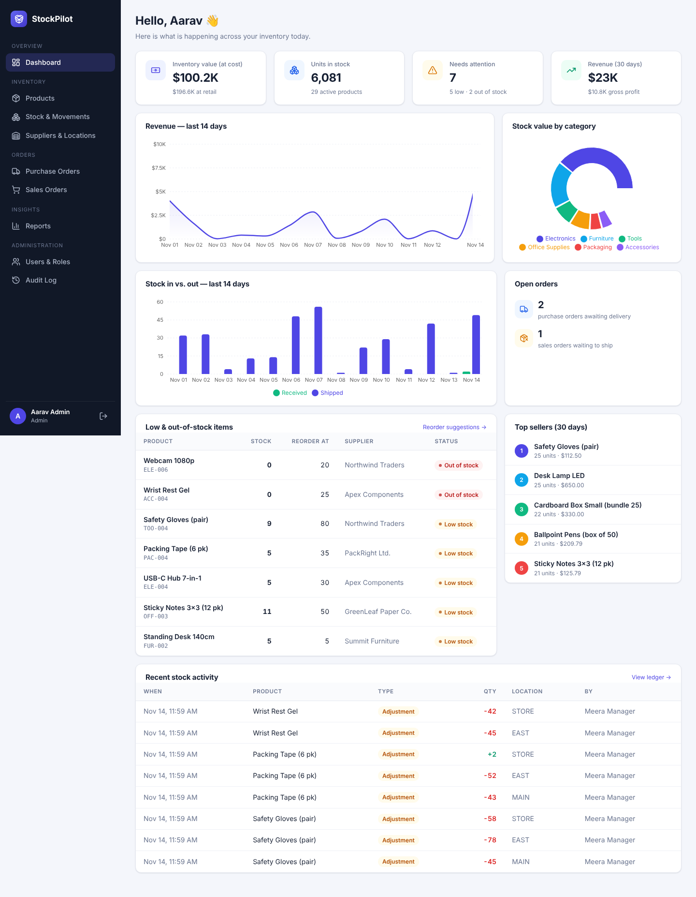

# StockPilot — Inventory Management Admin Panel

A full-stack inventory admin built with **React (Vite)**, **Node.js / Express** and **PostgreSQL**. It models how a small business really runs stock: multiple warehouses, purchase orders with partial receiving, sales orders, a complete movement ledger, reorder suggestions and four permission levels.



## Highlights

- **Multi-warehouse stock** with an append-only **movement ledger** (purchase, sale, adjustment, transfer in/out) and running balances.
- **Purchase orders**: draft → placed → partial/received, with **partial receiving** and **weighted-average cost** updates on delivery.
- **Sales orders**: pending → fulfilled/cancelled. Fulfilment is **atomic and all-or-nothing**; stock can never go negative, even under concurrent requests.
- **Reorder suggestions** grouped by supplier (subtracts quantities already on order) with a one-click **"Create draft PO"**.
- **Dashboard**: inventory value, low/out-of-stock alerts, 14-day revenue and in/out charts, top sellers, recent activity.
- **Role-based access** (Admin / Manager / Staff / Viewer) enforced on the server and mirrored in the UI.
- **Audit log** of every important change, CSV exports, JWT auth, request validation (Zod), rate-limited login, responsive UI.

## Roles

| Capability | Admin | Manager | Staff | Viewer |
|---|:--:|:--:|:--:|:--:|
| View products, stock, orders, dashboard | ✅ | ✅ | ✅ | ✅ |
| View reports | ✅ | ✅ | – | ✅ |
| Create sales orders, fulfil, cancel | ✅ | ✅ | ✅ | – |
| Receive goods on a PO, transfer stock | ✅ | ✅ | ✅ | – |
| Manage products, suppliers, categories | ✅ | ✅ | – | – |
| Create / place / cancel purchase orders | ✅ | ✅ | – | – |
| Stock adjustments (with reason) | ✅ | ✅ | – | – |
| CSV exports | ✅ | ✅ | – | – |
| Delete products, manage warehouses | ✅ | – | – | – |
| Manage users, view audit log | ✅ | – | – | – |

## Tech stack

| Layer | Choice |
|---|---|
| Frontend | React 18, React Router 6, Recharts, lucide-react, hand-written CSS (no UI framework) |
| Backend | Node.js (ESM), Express 4, `pg`, Zod, bcryptjs, jsonwebtoken, helmet, express-rate-limit |
| Database | PostgreSQL 16 (plain SQL schema with constraints, indexes, sequences) |
| Tests | `node:test` integration tests against a real database |

## Getting started

Requirements: Node.js 18+ and PostgreSQL 14+ (or Docker).

```bash
# 1. Database (skip if you already have Postgres)
docker compose up -d

# 2. Configure + install
cp server/.env.example server/.env      # adjust DATABASE_URL / JWT_SECRET if needed
npm run install:all

# 3. Create tables and load demo data
npm run db:reset

# 4. Run (two terminals)
npm run dev:server    # API  → http://localhost:4000
npm run dev:client    # UI   → http://localhost:5173
```

Demo logins (password `Password123!`): `admin@`, `manager@`, `staff@`, `viewer@` `stockpilot.dev`.

### Production build (single service)

```bash
npm run build     # builds client/dist
npm start         # Express serves the API and the built React app on one port
```

Set `NODE_ENV=production`, a strong `JWT_SECRET`, `DATABASE_URL` (and `DATABASE_SSL=true` for most managed Postgres) and `CORS_ORIGIN`.

### Tests

```bash
npm run db:reset && npm test
```
> Tests create their own records but run against the configured database — use a throwaway/dev DB, not production.

They cover authentication, RBAC, validation, weighted-average costing, partial receiving, all-or-nothing fulfilment, a **concurrency test** (two simultaneous orders competing for the same stock → exactly one succeeds), transfers, reports and CSV export.

## Architecture & design decisions

```
stockpilot/
├── server/                 Express API
│   └── src/
│       ├── db/             schema.sql, migrate.js, seed.js, pool.js (tx helper)
│       ├── middleware/     auth (JWT + requireRole), error handling
│       ├── routes/         auth, users, catalog, products, stock, purchaseOrders, salesOrders, dashboard, reports, audit
│       └── utils/          stock.js (single entry point for stock changes), csv, audit, errors
└── client/                 React SPA
    └── src/ (api/, context/, components/, pages/)
```

- **One choke point for stock changes.** Every quantity change goes through `applyMovement()`, which performs a guarded atomic `UPDATE … WHERE quantity + delta >= 0` and writes the ledger row in the same transaction. Overselling is impossible by construction; a `CHECK (quantity >= 0)` is the second line of defence.
- **Ledger, not just counters.** `stock_levels` holds current quantity per product/warehouse; `stock_movements` records every signed change with the resulting balance, user, reference and note.
- **Transactions everywhere it matters.** Receiving a PO, fulfilling a sales order and transfers each run in a single transaction and roll back entirely on any failure. Rows are locked (`FOR UPDATE`) to avoid double receive/fulfil races.
- **Permissions are re-checked on every request.** The JWT identifies the user, but the role and `active` flag are loaded from the DB each time, so demoting or deactivating someone takes effect immediately. The last active admin cannot be removed.
- **History is protected.** Products with transactions are archived rather than deleted; profit uses a unit-cost snapshot taken at fulfilment time.
- **Validation and errors.** Zod schemas on every write; PostgreSQL error codes are translated into clear 400/409 responses.

## API overview

All endpoints except `POST /api/auth/login` need `Authorization: Bearer <token>`.

| Area | Endpoints |
|---|---|
| Auth | `POST /auth/login`, `GET /auth/me`, `POST /auth/change-password` |
| Users (admin) | `GET/POST /users`, `PATCH /users/:id` |
| Catalogue | `/products` (filter, sort, paginate), `/categories`, `/suppliers`, `/warehouses` |
| Stock | `GET /stock/levels`, `GET /stock/movements`, `POST /stock/adjust`, `POST /stock/transfer` |
| Purchasing | `/purchase-orders` + `/:id/place`, `/:id/receive`, `/:id/cancel` |
| Sales | `/sales-orders` + `/:id/fulfill`, `/:id/cancel` |
| Insights | `GET /dashboard`, `GET /reports/valuation`, `GET /reports/reorder`, `GET /reports/export/{products,stock,movements}.csv` |
| Admin | `GET /audit` |

## Ideas for extension

Barcode scanning, batch/lot & expiry tracking, stock reservations for pending orders, email alerts for low stock, per-warehouse reorder levels, file uploads for product images, OpenAPI docs.

## License

MIT
